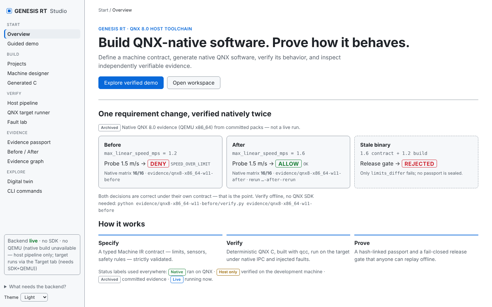

# GENESIS RT — The Physical World Compiler

**From human intent to tested QNX-native machine software.**

[](https://github.com/toskaman/genesis-rt/actions/workflows/host-ci.yml)
[](LICENSE)

> Status: functional alpha for the [QNX Global Hackathon](https://qnx.devpost.com/)
> (Developer Tooling & Host Tools), built 4 Nov 2026 onward. Host verification
> is fully working; QNX on-target execution is verified (native `qcc`
> build with 0 warnings, 16/16 on-target matrix, `qnx_verified: true`).
> No safety certification is claimed.



## 60-second pitch

Embedded control prototypes are slow to build and their test evidence is
usually a pile of screenshots. GENESIS RT turns a **constrained machine
description** into a **typed, inspectable specification (Machine IR)**,
generates a **native QNX 8.0 multi-process controller**, runs it, breaks it
on purpose with **seeded fault injection**, and produces a **hash-linked
evidence passport** where every green verdict links to a real execution
trace. One convincing proof-driven demo beats twenty speculative features.

## What's proven

- **Contract-aware native verification**: the on-target oracle derives
  expectations from the validated Machine IR — a valid limit change
  (1.2 → 1.6 m/s) flips the 1.5 m/s probe DENY → ALLOW and both
  revisions still pass 16/16; a stale build is refused with no passport.
- **Three public BEFORE/AFTER evidence packs**
  (`evidence/qnx8-x86_64-w11-before/`, `...-after/`,
  `...-after-rerun/`): 34 files each,
  15-link passport chains, SDK-free `verify.py`, tamper control
  included.
- **Native IPC execution timeline** from real QNX `CLOCK_MONOTONIC`
  timestamps (`evidence/ipc-timeline/`).
- **CI IR impact bridge** (`scripts/ci_ir_check.py`): changed-IR
  validation and impact reports on every push/PR.
- **Professional review dossier**: one-click ZIP export (report +
  raw data + offline verify) from any target operation.
- **Final submission video: DEFERRED BY OWNER.** The historical cut
  `docs/demo/genesis-rt-demo-w12.mp4` (154.664 s) predates the current
  Studio and is **not** the final video; see `submission/VIDEO_DEFERRED.md`.

Canonical numbers live in [docs/CLAIMS.md](docs/CLAIMS.md).

## Architecture

```
[CLI / Web API / GENESIS Studio]        genesis-rt demo
         |
[Planner] -> [Machine IR v1 | v2] -> [strict per-version VALIDATION]
             (AMR, conveyor,               |
              industrial cell)   [Deterministic codegen v1 / v2]
                                           |
                       [Multi-build provenance: host mirror + qcc x86_64]       
                                           |
                                 [QNX 8.0 target (QEMU)]
                                  guard/controller/device/status/
                                  supervisor/faultinject/cellcheck
                                  (C, native MsgSend/MsgReceive/MsgReply)
                                           |
[Simulator + Fault Lab] <-- host mirror --> [16-step target matrix + traces]
         |
[Compare: broken vs fixed]
         |
[Evidence passport + fail-closed release gate]
```

See [docs/architecture.md](docs/architecture.md).

## Quickstart (no QNX SDK needed)

```sh
git clone https://github.com/toskaman/genesis-rt.git
cd genesis-rt
pip install -e '.[dev]'        # or: PYTHONPATH=host
python -m pytest tests/ -q     # host suite, incl. C/Python conformance
python scripts/run_verified_demo.py
python scripts/replay.py artifacts/runs/*/passport.json
```

(With several runs present, pass the exact passport path the demo
printed instead of the glob.)

Then start the live workbench (`genesis-rt serve`) and open
http://127.0.0.1:8077/ — Studio Live: projects with
revision history, a Machine IR designer with state graphs, and an SSE
pipeline runner (validate → generate → run → passport → diff), plus the
trace/passport/diff inspectors. `ui/dashboard.html` stays a dependency-free
passport inspector that also works straight from disk.

Full install reference (prerequisites, Windows + Linux, environment
variables, troubleshooting, uninstall): [docs/INSTALL.md](docs/INSTALL.md).

With a QNX SDP 8.0 SDK installed: [docs/quickstart-qnx8-qemu.md](docs/quickstart-qnx8-qemu.md)
(`scripts/qnx_env_check.py` probes your setup; without an SDK the pipeline
records QNX steps as `blocked`, never as passed).

## Commands

| Command | What it does |
|---|---|
| `genesis-rt validate <ir>` | strict Machine IR validation |
| `genesis-rt plan "<request>"` | constrained intent → validated IR proposal |
| `genesis-rt generate <ir> --out <dir>` | deterministic QNX C build files |
| `genesis-rt simulate <ir> [--scenario id]` | nominal (or named) scenario for AMR / conveyor / cell, v1 or v2 |
| `genesis-rt faults <ir>` | declared fault campaign with oracles (AMR 8, conveyor 5, cell 4) |
| `genesis-rt demo` | full pipeline → evidence passport + gate verdict |
| `genesis-rt external-write-manifest` | hash an existing build dir into a manifest |
| `genesis-rt external-check` | stale-binary check of a build dir vs its manifest |
| `genesis-rt check-env` | probe for QNX SDK toolchain |
| `genesis-rt serve` | local web API (needs `api` extra) |

## QNX evidence for judges

- Native IPC: `target/qnx8/guard` + `controller` (`name_attach`/`MsgReceive`/
  `MsgReply`/`MsgSend`), fixed protocol in `target/qnx8/include/genesis_ipc.h`.
- Resource manager `/dev/genesis/status`, supervisor with reset authority.
- Shared guard policy proven identical in C and Python by
  `tests/integration/test_c_conformance.py` via `guard_vector`.
- Codelabs: [native IPC controller in 45 min](docs/codelab/README.md),
  [advanced QNX deep-dive](docs/codelab/ADVANCED-QNX.md),
  [stale-binary detection for your own build in 15 min](docs/codelab/EXTERNAL-BUILD.md).
- Start here: [docs/jury/START_HERE.md](docs/jury/START_HERE.md).

## Honest known limitations

- Host fault results are **simulated**; QNX on-target runs are verified by
  the authors (16/16 matrix) and reproducible with an SDK + QEMU setup
  ([docs/PROGRESS.md](docs/PROGRESS.md)).
- QEMU timing is for regression comparison, not production guarantees.
- Prototype only: no functional-safety qualification, simulation-only outputs.
- Full detail: [docs/limitations-and-safety.md](docs/limitations-and-safety.md).

## FAQ

**Is this original work?** Yes — created during the hackathon entry period for
this submission; see [docs/jury/COMPLIANCE.md](docs/jury/COMPLIANCE.md).

**Why Apache-2.0?** The project brief asked to match the OpenBridge license if
possible. The referenced OpenBridge project uses PolyForm Strict 1.0.0, which
is not an open-source license and would violate the Devpost requirement for a
public open-source repository — so Apache-2.0 (OSI-approved, GitHub-detectable,
also the license the OpenBridge design system converges to) was chosen instead.
Details in [docs/jury/COMPLIANCE.md](docs/jury/COMPLIANCE.md).

**Does the gate ever pass without tests?** No — `no-test => no-pass` is tested
(`tests/unit/test_evidence_gate.py`): missing, skipped, crashed or tampered
evidence always yields FAIL.

## License

Apache-2.0, see [LICENSE](LICENSE).
